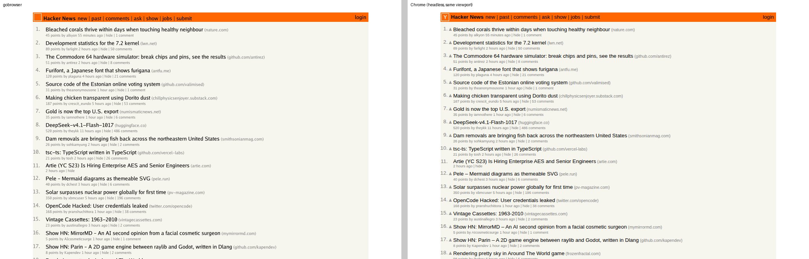

# gobrowser2

A small web browser written from scratch in Go. It fetches a page, parses HTML and CSS, computes styles, lays out the page and paints it to a PNG. The target is to render as much of [Hacker News](https://news.ycombinator.com/) as possible ([#1](https://github.com/lukehoban/gobrowser2/issues/1)).



*Left: `gobrowser` rendering news.ycombinator.com. Right: headless Chrome at the same 1024px viewport. Full render: [docs/hn.png](docs/hn.png).*

## What works

- **Networking**: `net/http` for http(s), with redirects and gzip. Also loads `file://` URLs and local paths, plus `<link rel=stylesheet>`, `<style>` and `` subresources.
- **HTML**: hand-written tokenizer and tree builder.
  - Implied tags, tables (implicit `tbody`/`tr`, foster parenting).
  - Character references.
  - Quirks-mode detection.
- **CSS**: parser covering selectors (type, class, id, attribute, structural pseudo-classes, combinators), specificity, `!important`, `@media` (width queries) and common shorthands.
- **Style**:
  - Cascade with a UA stylesheet plus a quirks-mode stylesheet.
  - Inheritance.
  - Presentational attributes HN relies on: `bgcolor`, `width`, `cellpadding`, `align`, `valign` and others.
- **Layout**:
  - Block layout with sibling margin collapsing and auto margins.
  - Inline layout with line breaking.
  - Inline-blocks and form controls.
  - Images.
  - CSS 2.1 auto table layout with `colspan`.
- **Paint**: backgrounds, borders, anti-aliased text (embedded Go fonts), underlines, list markers and scaled raster images (PNG, GIF, JPEG).

## What's next

- SVG images and CSS `background-image`, for the HN logo and vote arrows ([#9](https://github.com/lukehoban/gobrowser2/issues/9)).
- `line-height: normal` from font metrics, so rows line up with Chrome ([#22](https://github.com/lukehoban/gobrowser2/issues/22)).
- Parent/child margin collapsing ([#21](https://github.com/lukehoban/gobrowser2/issues/21)).
- Automated visual diff against headless Chrome in CI ([#20](https://github.com/lukehoban/gobrowser2/issues/20)).
- All open work: [sub-issues of #1](https://github.com/lukehoban/gobrowser2/issues/1).

## Usage

```sh
go run ./cmd/gobrowser -o hn.png https://news.ycombinator.com/
go run ./cmd/gobrowser -o fixture.png testdata/hn-like.html   # offline, HN-shaped fixture
```

Flags:

| Flag | Meaning |
|---|---|
| `-width` | Viewport width (default 1024). |
| `-height` | Output height. The default `0` renders the full page. |
| `-dump-dom` | Print the parsed DOM. |
| `-v` | Print warnings, such as subresources that failed to load. |

## Layout of the code

| Package | Stage |
|---|---|
| `internal/fetch` | http(s) and file loading |
| `internal/html`, `internal/dom` | HTML tokenizer, tree builder, DOM |
| `internal/css` | CSS parser, selectors, colors, shorthands |
| `internal/style` | cascade, computed styles, UA and quirks stylesheets |
| `internal/fonts` | font faces and text measurement (Go fonts via `golang.org/x/image`) |
| `internal/layout` | box tree, block, inline and table layout |
| `internal/render` | painting to an `image.RGBA` |
| `internal/browser` | wires the pipeline together |
| `cmd/gobrowser` | the CLI |

`go test ./...` runs unit tests for each stage. CI also renders the fixture and live HN, and uploads the PNGs as build artifacts.
