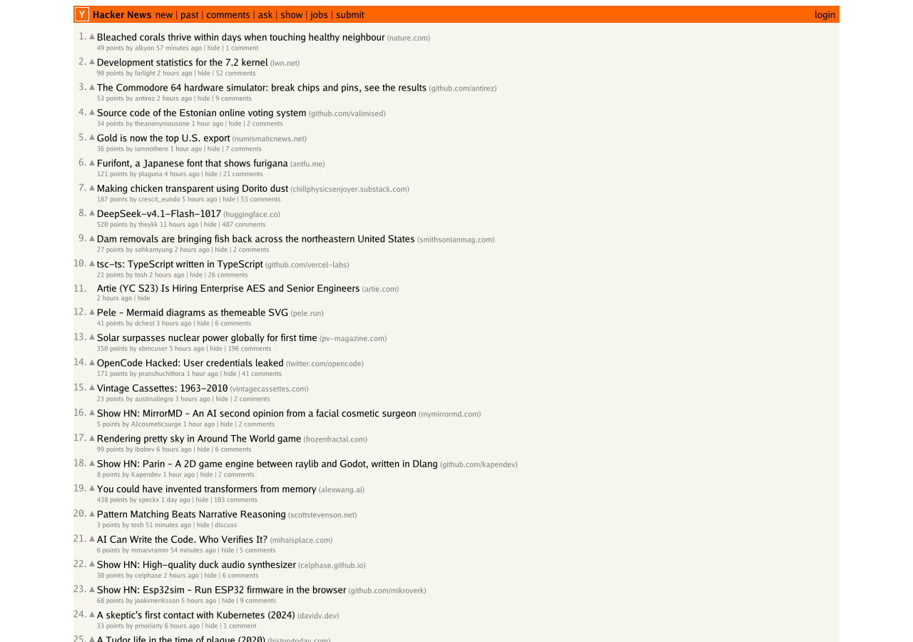

# gobrowser2

A small web browser written from scratch in Go. It fetches a page, parses HTML and CSS, computes styles, lays out the page and paints it to a PNG. The target is [Hacker News](https://news.ycombinator.com/). See the epic, [#1](https://github.com/lukehoban/gobrowser2/issues/1).



*news.ycombinator.com rendered by gobrowser at 1280px (top of the page). Side-by-side with headless Chrome: [docs/compare-chrome.png](docs/compare-chrome.png).*

## Usage

```sh
go run ./cmd/gobrowser -o hn.png https://news.ycombinator.com/
go run ./cmd/gobrowser -o fixture.png testdata/hn/index.html   # local files work too
go run ./cmd/gobrowser -dump=layout https://news.ycombinator.com/   # or -dump=dom
```

Flags: `-o` output PNG, `-width` viewport width (default 1280), `-dump dom|layout`, `-timeout`.

## What works

| Stage | Package | Notes |
|---|---|---|
| Fetch | `internal/fetch` | `net/http`, plus `file:` and `data:` URLs. Charset detection. Remote pages can't load `file:` subresources. |
| HTML | `internal/dom` | `golang.org/x/net/html` (WHATWG tree construction) wrapped into our own DOM. Quirks-mode detection (HN has no doctype). |
| CSS | `internal/css` | Our own parser. Selectors: type, class, id, attribute, descendant, `>`, `+` and `~`, plus `:link`, `:first-child`, `:last-child` and `:root`. `@media` is skipped (desktop only). |
| Style | `internal/style` | Cascade (UA < hints < author < inline, `!important`), inheritance, shorthands, HTML presentational hints (`bgcolor`, `width`, `align`, `cellpadding`, ...) and the quirks-mode table rules. |
| Layout | `internal/layout` | Block layout with sibling margin collapsing, inline layout with line breaking and `white-space`, and CSS 2.1 auto table layout with `colspan`. |
| SVG | `internal/svg` | Our own renderer: paths (all commands, including arcs), basic shapes, fills, transforms and `viewBox`. Draws HN's logo and vote arrows. |
| Paint | `internal/render` | Backgrounds, background images, borders, images and anti-aliased text using the Go fonts (`golang.org/x/image`). |

Text is drawn with the Go fonts using Verdana's vertical metrics, because Verdana can't be redistributed. Words are a little narrower than in Chrome.

## What's next

Open work is tracked in the sub-issues of [#1](https://github.com/lukehoban/gobrowser2/issues/1). Highlights:

- Font metrics closer to Chrome's, so rows line up ([#22](https://github.com/lukehoban/gobrowser2/issues/22)).
- Parent/child margin collapsing ([#21](https://github.com/lukehoban/gobrowser2/issues/21)).
- Automated visual diff against headless Chrome in CI ([#20](https://github.com/lukehoban/gobrowser2/issues/20)).

## Development

```sh
go test -race ./...
```

CI runs gofmt, `go vet`, the tests and a build. It also renders `testdata/hn/index.html` (a synthetic HN-shaped page) and the live HN front page, and uploads both PNGs as the `renders` artifact.
